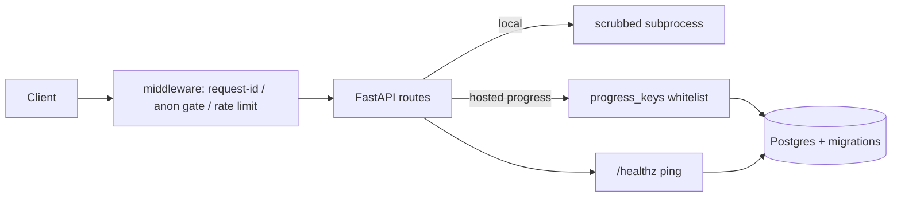

# Engineering features

Operational and security hardening for the PyForge app and deploy path.

## Purpose

Keep the learning product reliable in CI, safer in local mode, and operable
when hosted publicly — without changing the curriculum pedagogy.

## Scope

- App process: FastAPI (`app/main.py`), auth, store, runner, rate limit
- Frontend static assets (`app/static/`)
- CI (`.github/workflows/ci.yml`), Dependabot
- Hosted backups (`scripts/backup_postgres.sh`)
- Terraform remote state + bootstrap cron

## Inputs / outputs

| Input | Output |
|-------|--------|
| `PYFORGE_MODE`, env secrets | Mode-gated API surface |
| Learner code (local only) | Pass/fail from sandboxed subprocess |
| Browser progress posts (hosted) | Whitelisted rows in Postgres |
| `/healthz` probes | 200 ready / 503 DB down (hosted) |

## Dependencies

FastAPI, uvicorn, pydantic; hosted adds psycopg2, itsdangerous, httpx.
Local exercise runner adds the scientific stack in `app/requirements.txt`.

## Functional flow

## Failure paths

| Failure | Behaviour |
|---------|-----------|
| Rate limit exceeded | 429 `slow down` |
| Unknown exercise/milestone on write/merge | dropped or 404 |
| OAuth state replay | 400 after nonce consume |
| Postgres down (hosted) | `/healthz` → 503 |
| Corrupt local JSON progress | start fresh + warning log |

## Security considerations

- Hosted: no `/api/run`; progress is honor-system (see DEPLOY.md)
- `ALLOW_ANONYMOUS=false` forces GitHub sign-in for UI/API
- Local runner: env scrub, isolated cwd, POSIX rlimits — residual Docker-network access is intentional
- CSP baseline set in app middleware; Caddy may tighten further

## Performance considerations

- Hosted compute is on the client (Pyodide)
- Anonymous `/api/curriculum` gets short `Cache-Control`
- SQLite rate-limit DB shared across uvicorn workers on one host

## Troubleshooting

| Symptom | Look at |
|---------|---------|
| 503 on `/healthz` | Postgres connectivity / `DATABASE_URL` |
| Everyone signed out | `SECRET_KEY` changed / missing |
| 401 on every API call | `ALLOW_ANONYMOUS=false` without a session |
| 429 under ALB | `TRUST_PROXY=true` so limits key on real client IP |
| Backup cron silent | `/var/log/pyforge-backup.log` on the EC2 host |
