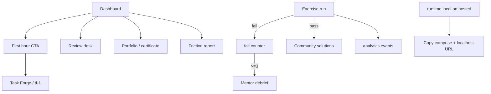

# Learning features

Product features that improve onboarding, retention, and completion proof.

## Purpose

Turn the curriculum into a path people finish: guided first hour, progressive
infra unlock, mentor debriefs, spaced review, portfolio artifacts, friction
analytics, gated community solutions, and local deep-links for JVM exercises.

## Scope

| # | Feature | Surfaces |
|---|---------|----------|
| 1 | Completion artifacts | Portfolio README + honor-system certificate |
| 2 | First-hour onboarding | Dashboard card → Task Forge / `tf-1` |
| 3 | Progressive stack unlock | `stack_tier` chips + project banner + Environment tab |
| 4 | Mentor mode | Unlocks after 3 failed checks; no full solution dump |
| 5 | Spaced review | Review desk — weak exercises + weekly interview drills |
| 7 | Local deep links | Hosted `runtime: local` exercises copyable launch script |
| 8 | Friction analytics | Event stream + drop-off ranking |
| 9 | Community solutions | Alternate solutions after pass |

## Inputs / outputs

| Input | Output |
|-------|--------|
| Progress + optional review_state | Portfolio markdown, review queue |
| `exercise_fail` ×3 | Mentor walkthrough panel |
| Passed exercise id | Community solutions JSON |
| Analytics events | Friction report rows |

## Dependencies

Curriculum assembly (`mentor_debrief`, `stack_tier`, `local_launch`),
`analytics_store` JSON file, browser `localStorage` for review/fail counts.

## Functional flow



## Failure paths

| Case | Behaviour |
|------|-----------|
| Solutions before pass | HTTP 403 |
| Empty analytics | Friction table shows empty state |
| Anonymous hosted portfolio | POST `/api/portfolio` with localStorage progress |

## Security considerations

- Certificate and portfolio are explicitly honor-system on hosted mode.
- Community solutions require a pass (store) or anonymous `?passed=1` attest.
- Mentor debrief never includes reference solution source.

## Performance considerations

- Analytics capped at last 5000 events on disk.
- Review queue computed in-process from curriculum (no heavy queries).

## Troubleshooting

| Symptom | Check |
|---------|-------|
| No onboarding card | `localStorage.pyforge_onboarding_v1 === '1'` — clear it |
| Mentor never unlocks | Fail the check 3 times (not syntax-only editor edits) |
| Friction empty | Run exercises; events write to `app/data/analytics.json` |
| Solutions 403 | Pass the exercise first |

## Test commands

```bash
pytest tests/test_learning_features.py -q
```
